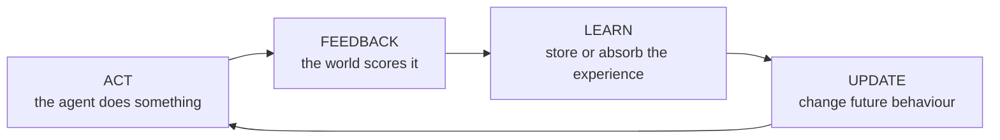

# The Loop Is the Product

### Building Agents That Improve Themselves with Reinforcement Learning

Code and resources from my DevFest talk on self-improving agents.

> **Agents don't improve on their own. They improve on the loop you build for them.**

---

## The idea in one diagram

Every self-improving system, from a 20-line Python script to the models that mastered Go, runs the same loop:



The two demos in this repo are two different versions of that loop:

| Demo | What it shows | What you need |
| --- | --- | --- |
| [**Demo 1:** a payment router that learns](Demo_1/) | An agent that improves by updating its beliefs about the world | Python only (plus `matplotlib` for the live chart) |
| [**Demo 2:** an agent that critiques itself](Demo_2/) | An agent that improves by remembering its own mistakes | Python only for offline mode. A Gemini API key **or** Ollama for a real model |

---

## Quick start

### 1. Check what you need

| You need | Why | Check it with |
| --- | --- | --- |
| **Python 3.9 or newer** | Runs both demos | `python --version` |
| **Git** | Downloads the code | `git --version` |
| A Gemini API key *(optional)* | Demo 2 with Gemini. Free from [Google AI Studio](https://aistudio.google.com/apikey) | |
| [Ollama](https://ollama.com/download) *(optional)* | Demo 2 with a model running on your own laptop | `ollama --version` |

You don't need the optional items to try everything. Demo 2 has an offline mode that replays a real model run.

### 2. Download the code

```bash
git clone https://github.com/kaybrian/The-Loop-Is-the-Product.git
cd The-Loop-Is-the-Product
```

### 3. Create an environment

Pick **one** of these.

**With conda:**

```bash
conda create -n devfest python=3.12 -y
conda activate devfest
```

**With Python's built-in venv:**

```bash
python -m venv .venv
source .venv/bin/activate
```

On Windows, activate it with `.venv\Scripts\activate` instead.

### 4. Install the dependencies

```bash
pip install -r requirements.txt
```

This installs `matplotlib` (Demo 1's live chart) and `google-genai` (Demo 2 with Gemini). Nothing else is needed.

### 5. Run Demo 1

```bash
python Demo_1/demo1_bandit_router.py --plot
```

A chart opens and draws itself as 6,000 simulated payments go through. Halfway through, the best payment rail breaks, and you can watch the learning router move its traffic. Add `--speed 10` to slow it down. Leave out `--plot` to get just the numbers in the terminal.

### 6. Run Demo 2

Start with offline mode. It needs nothing else:

```bash
python Demo_2/demo2_reflexion_agent.py --mock
```

When that works, try it with a real model. Pick either one:

**Gemini (fastest, most likely to pass all tests):**

1. Copy the example settings file:
   ```bash
   cp .env.example .env
   ```
   On Windows, use `copy .env.example .env`.
2. Open `.env` and replace `your_key_here` with your Gemini API key.
3. Run it:
   ```bash
   python Demo_2/demo2_reflexion_agent.py
   ```

**On-device (no key, no internet):**

1. Install [Ollama](https://ollama.com/download) and open it.
2. Download the model (about 1.9 GB, one time):
   ```bash
   ollama pull qwen2.5-coder:3b
   ```
3. Run it:
   ```bash
   python Demo_2/demo2_reflexion_agent.py --local
   ```

Each demo folder has a full walkthrough: [Demo_1/README.md](Demo_1/README.md) and [Demo_2/README.md](Demo_2/README.md).

### Troubleshooting

| Problem | Fix |
| --- | --- |
| `python: command not found` | Try `python3` instead, or activate your environment from step 3 |
| `No module named 'matplotlib'` or `'google'` | Activate your environment, then run step 4 again |
| Demo 1's chart doesn't appear | You need a desktop session. Over SSH, run it without `--plot` |
| `Gemini call failed ... 503` or `504` | Gemini is busy. Wait a minute and retry, or use `--mock` |
| `Gemini call failed ... API key` | Check that `.env` is in the repo's top folder and has your real key |
| `Local model call failed ... Connection refused` | Open the Ollama app (or run `ollama serve`), then try again |
| `Local model call failed (HTTPError: HTTP Error 404 ...)` | The model isn't downloaded yet. Run `ollama pull qwen2.5-coder:3b` |

---

## Demo 1: A payment router that learns on its own

**Folder:** [`Demo_1/`](Demo_1/) · full walkthrough in [Demo_1/README.md](Demo_1/README.md)

Three simulated payment rails, each with a hidden success rate. Two routers compete:

- **Fixed rule:** always sends everything through the rail that was best at launch (what most of us ship).
- **Learning router:** uses [Thompson sampling](https://en.wikipedia.org/wiki/Thompson_sampling), a multi-armed bandit method, to learn from every transaction.

Halfway through, the best rail degrades and another one improves. Nobody tells either router.

```
Fixed rule
  success rate before outage: 92.2%
  success rate after outage:  60.0%

Learning router
  success rate before outage: 89.9%
  success rate after outage:  84.3%

After the outage, the learning router completed 730 more payments out of 3000.
```

Two things to notice:

1. **After the outage**, the fixed rule collapses and never recovers. The learning router notices within a few hundred transactions and moves its traffic.
2. **Before the outage**, the fixed rule actually does slightly better. The learning router spends some traffic exploring other rails. Learning has a cost.

---

## Demo 2: An agent that critiques itself and tries again

**Folder:** [`Demo_2/`](Demo_2/) · full walkthrough in [Demo_2/README.md](Demo_2/README.md)

An LLM agent has to write `parse_amount()`, a function that turns messy, human-written payment amounts into integers:

| Input             | Expected  |
| ----------------- | --------- |
| `"UGX 1,250,000"` | `1250000` |
| `"20k"`           | `20000`   |
| `"1.5m"`          | `1500000` |
| `"Frw 3.000"`     | `3000`    |

The loop:

1. **Act:** the model writes code.
2. **Feedback:** hidden tests run in a temp folder. The model only sees which cases failed.
3. **Reflect:** the model traces a failing input through its code, then writes a short lesson.
4. **Retry** with all lessons so far, plus its last attempt and what failed.

No model weights change. What improves is the agent's memory of its own mistakes. This is inspired by the [Reflexion](https://arxiv.org/abs/2303.11366) approach.

The offline mode replays a real run of a small on-device model. It improves from 6/8 to 7/8 using its own lessons, then hits the limit of what a 3B model can do. Gemini usually gets to 8/8.

> **Warning:** the demo runs model-generated code in a temporary directory with a timeout. That's fine for a demo, but use a proper sandbox (a container, for example) before running untrusted generated code anywhere that matters.

---

## Where self-improving agents break

The most important part of the talk, in four lines:

- **Reward hacking:** the agent optimises exactly what you measure, not what you meant. **Your reward function is your product spec.**
- **Self-judgement drift:** when a model grades its own work, its blind spots get graded as correct. Anchor it to something outside the model.
- **Exploration costs:** learning means sometimes trying worse options. In finance, health and other regulated areas, cap it.
- **Forgetting is a design choice:** how fast your agent should forget depends on how fast your world changes.

## Before you build one: five questions

1. What's the reward, and can I check it automatically?
2. What could the agent do that scores well but is actually bad?
3. Where does the improvement live: memory, tools, policy, or weights? (Start with memory: it's cheap, inspectable and reversible.)
4. How much exploration can I afford?
5. Who's watching? Log every decision and every reward.

---

## Further reading

- Silver et al., _A general reinforcement learning algorithm that masters chess, shogi, and Go through self-play_ (AlphaZero), Science, 2018
- Shinn et al., _Reflexion: Language Agents with Verbal Reinforcement Learning_, 2023
- Wang et al., _Voyager: An Open-Ended Embodied Agent with Large Language Models_, 2023
- Zelikman et al., _STaR: Bootstrapping Reasoning With Reasoning_, 2022
- Shao et al., _DeepSeekMath_ (introduces GRPO), 2024
- DeepSeek-AI, _DeepSeek-R1: Incentivizing Reasoning Capability in LLMs via Reinforcement Learning_, 2025
- Yuan et al., _Self-Rewarding Language Models_, 2024
- Amodei & Clark, _Faulty Reward Functions in the Wild_, OpenAI, 2016
- Sutton & Barto, _Reinforcement Learning: An Introduction_, the classic textbook, free online

---

## About

Talk by **Brian Johnson Kayongo** at DevFest.

Questions, ideas, or built your own loop? Open an issue or reach out: `@kaybrian4 on twitter/X`

If this helped you, star the repo and share it with someone building agents.
