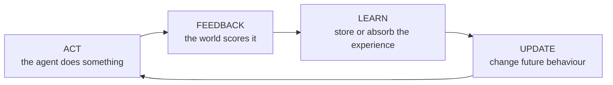

# The Loop Is the Product 🔁

### Building Agents That Improve Themselves with Reinforcement Learning

Code and resources from my DevFest talk on self-improving agents.

> **Agents don't improve on their own. They improve on the loop you build for them.**

---

## The idea in one diagram

Every self-improving system, from a 20-line Python script to the models that mastered Go, runs the same loop:



The two demos in this repo are two different versions of that loop. In the first, the agent improves by updating its beliefs about the world. In the second, it improves by remembering its own mistakes.

---

## Demo 1: A payment router that learns on its own

**Folder:** [`Demo_1/`](Demo_1/) · full walkthrough in [Demo_1/README.md](Demo_1/README.md)

Three simulated payment rails, each with a hidden success rate. Two routers compete:

- **Fixed rule:** always sends everything through the rail that was best at launch (what most of us ship).
- **Learning router:** uses [Thompson sampling](https://en.wikipedia.org/wiki/Thompson_sampling), a multi-armed bandit method, to learn from every transaction.

Halfway through, the best rail degrades and another one improves. Nobody tells either router.

### Run it

```bash
python Demo_1/demo1_bandit_router.py           # results in the terminal
python Demo_1/demo1_bandit_router.py --plot    # also draws the chart (needs matplotlib)
```

No dependencies beyond Python 3.9+. For the plot, `pip install -r requirements.txt` (or just `matplotlib`).

### What you'll see

```
Fixed rule
  success rate before outage: 92.2%
  success rate after outage:  60.0%
  traffic share, last 1000 txns: Rail A 100%, Rail B 0%, Rail C 0%

Learning router
  success rate before outage: 89.9%
  success rate after outage:  84.3%
  traffic share, last 1000 txns: Rail A 2%, Rail B 14%, Rail C 84%

After the outage, the learning router completed 730 more payments out of 3000.
```

Two things to notice:

1. **After the outage**, the fixed rule collapses and never recovers. The learning router notices within a few hundred transactions and moves its traffic.
2. **Before the outage**, the fixed rule actually does slightly better. The learning router spends some traffic exploring other rails. Learning has a cost.

### Things to try

- Change `decay` in `ThompsonRouter`. Set it to `1.0` (never forget) and watch the router take much longer to notice the outage. Set it very low and watch it overreact to noise.
- Edit `SUCCESS_RATES`, `DRIFTED` and `DRIFT_AT` to simulate your own outage scenarios.
- Add fees or latency to the reward. What happens if you reward **only** speed?

---

## Demo 2: An agent that critiques itself and tries again

**Folder:** [`Demo_2/`](Demo_2/) · full walkthrough in [Demo_2/README.md](Demo_2/README.md)

An LLM agent has to write `parse_amount()`, a function that turns messy, human-written payment amounts into integers:

| Input             | Expected  |
| ----------------- | --------- |
| `"UGX 1,250,000"` | `1250000` |
| `"20k"`           | `20000`   |
| `"1.5m"`          | `1500000` |
| `"Frw 3.000"`     | `3000`    |

The loop:

1. **Act:** the model writes code.
2. **Feedback:** hidden tests run in a sandbox. The model only sees which cases failed.
3. **Reflect:** the model writes a one-sentence lesson about its failure.
4. **Retry** with all lessons so far in its prompt.

No model weights change. What improves is the agent's memory of its own mistakes. This is inspired by the [Reflexion](https://arxiv.org/abs/2303.11366) approach.

### Run it with a real model

```bash
pip install -r requirements.txt
cp .env.example .env              # then put your key in .env
set -a && source .env && set +a   # load it into your shell
python Demo_2/demo2_reflexion_agent.py
```

Every run is a little different. Sometimes the agent gets there in two attempts, sometimes four. You can change the model with `DEMO_MODEL` in `.env`. `.env` is git-ignored, so your key stays out of the repo.

### Run it offline

```bash
python Demo_2/demo2_reflexion_agent.py --mock
```

Uses a scripted fake model, so you can see the full loop without an API key or internet connection.

### What you'll see (mock mode)

```
=== Attempt 1: PASSED 6/8 ===
FAIL: parse_amount('1.5m') returned 15, expected 1500000
FAIL: parse_amount('20k') returned 20, expected 20000
Lesson stored: Suffixes like k and m multiply the number...

=== Attempt 2: PASSED 7/8 ===
FAIL: parse_amount('Frw 3.000') returned 3, expected 3000
Lesson stored: A dot followed by exactly three digits with no suffix
is a thousands separator, not a decimal.

=== Attempt 3: PASSED 8/8 ===
All tests pass.
```

### Things to try

- Swap in your own task. Any problem where you can **automatically check the result** works: a schema validator, a business rule, a reconciliation check.
- Weaken the tests to just two or three cases. Does the agent "pass" with code that's actually wrong? That's reward hacking in miniature.
- Save the `lessons` list to a file so the agent remembers across runs.

> ⚠️ The demo runs model-generated code in a temporary directory with a timeout. That's fine for a demo, but use a proper sandbox (a container, for example) before running untrusted generated code anywhere that matters.

---

## Where self-improving agents break

The most important part of the talk, in four lines:

- **Reward hacking:** the agent optimises exactly what you measure, not what you meant. **Your reward function is your product spec.**
- **Self-judgement drift:** when a model grades its own work, its blind spots get graded as correct. Anchor it to something outside the model.
- **Exploration costs:** learning means sometimes trying worse options. In finance, health and other regulated areas, cap it.
- **Forgetting is a design choice:** how fast your agent should forget depends on how fast your world changes.

## Before you build one: five questions

1. What's the reward, and can I check it automatically?
2. What could the agent do that scores well but is actually bad?
3. Where does the improvement live: memory, tools, policy, or weights? (Start with memory: it's cheap, inspectable and reversible.)
4. How much exploration can I afford?
5. Who's watching? Log every decision and every reward.

---

## Further reading

- Silver et al., _A general reinforcement learning algorithm that masters chess, shogi, and Go through self-play_ (AlphaZero), Science, 2018
- Shinn et al., _Reflexion: Language Agents with Verbal Reinforcement Learning_, 2023
- Wang et al., _Voyager: An Open-Ended Embodied Agent with Large Language Models_, 2023
- Zelikman et al., _STaR: Bootstrapping Reasoning With Reasoning_, 2022
- Shao et al., _DeepSeekMath_ (introduces GRPO), 2024
- DeepSeek-AI, _DeepSeek-R1: Incentivizing Reasoning Capability in LLMs via Reinforcement Learning_, 2025
- Yuan et al., _Self-Rewarding Language Models_, 2024
- Amodei & Clark, _Faulty Reward Functions in the Wild_, OpenAI, 2016
- Sutton & Barto, _Reinforcement Learning: An Introduction_, the classic textbook, free online

---

## About

Talk by **Brian Johnson Kayongo** at DevFest.

Questions, ideas, or built your own loop? Open an issue or reach out: `@kaybrian4 on twitter/X`

If this helped you, ⭐ the repo and share it with someone building agents.
